# BatteryLife AI — Battery Lifespan Prediction System

A machine-learning-powered web application for monitoring lithium-ion battery performance, analysing degradation, and predicting Remaining Useful Life (RUL).

BatteryLife AI integrates a Laravel web application with a Python FastAPI prediction service to support battery management, measurement tracking, predictive analytics, and report generation.

**Project Title:** Design and Implementation of a Laravel 13-Based Web System for Lithium-Ion Battery Lifespan Prediction Using Machine Learning.

---

## Project Overview

Lithium-ion batteries gradually lose capacity as they age and undergo repeated charge and discharge cycles. Monitoring battery performance and estimating remaining useful life can help identify degradation trends and support maintenance planning.

Traditional battery monitoring methods may require manual analysis of measurements and historical records. Machine learning provides an approach for analysing these measurements and estimating battery lifespan using patterns learned from historical data.

BatteryLife AI addresses this problem by combining a web-based battery management platform with a trained machine-learning model.

The application is designed to provide a centralised platform for:

- Registering and managing battery records.
- Recording and importing battery measurement data.
- Monitoring battery capacity, voltage, temperature, and cycle information.
- Reviewing battery performance and degradation trends.
- Predicting Remaining Useful Life using machine learning.
- Estimating battery end-of-life cycles according to the project's defined threshold.
- Reviewing historical prediction results.
- Generating reports and PDF documents.
- Managing user accounts and application access.
- Displaying relevant notifications and battery information.

The project demonstrates the integration of web application development, database management, REST API communication, and predictive analytics.

## Project Objectives

The main objective is to design and implement a web-based system that uses machine learning to estimate the remaining useful life of lithium-ion batteries.

The specific objectives are to:

1. Develop a web-based platform for managing battery information.
2. Provide functionality for recording and importing battery measurements.
3. Analyse battery performance and degradation using historical measurement data.
4. Integrate a trained machine-learning model into a Laravel web application.
5. Estimate Remaining Useful Life and the expected end-of-life cycle from supplied measurements.
6. Present battery information and prediction results through a dashboard.
7. Maintain prediction history for review and comparison.
8. Generate reports that support battery monitoring and maintenance decisions.
9. Implement authentication and appropriate user access controls.
10. Demonstrate communication between Laravel and a Python-based machine-learning API.

---

## Key Features

### Welcome Page

The welcome page introduces BatteryLife AI and provides visitors with an overview of the platform. It serves as the main entry point and guides users towards the authentication interface and the system's available features.


### Login Page

The login page provides the authentication interface for authorised users. After successful authentication, users can access the system features permitted by their assigned access level.


### 1. Dashboard

The dashboard provides a centralised view of the system and its available battery information.

It helps users access battery records, review system activity, and navigate to relevant monitoring and reporting features.


### 2. Battery Management

The battery management module allows users to maintain battery records and their associated information.

These records provide the foundation for measurement tracking, historical analysis, and prediction workflows.


### 3. CSV Data Import

The CSV import functionality helps users introduce measurement data into the application without manually entering every record.

Imported files must follow the structure and validation rules expected by the application.

### 4. Machine-Learning Prediction

BatteryLife AI integrates a Python-based prediction service with the Laravel application.

The Laravel application sends relevant input features to the FastAPI service. The service loads the trained model, processes the supplied information, and returns the prediction result.

The selected machine-learning algorithm is a **Gradient Boosting Regressor**.


### 5. Remaining Useful Life (RUL) Estimation

Remaining Useful Life represents the estimated number of battery cycles remaining before the battery reaches the project's defined end-of-life threshold.

The system uses historical cycling data and the trained regression model to estimate this value.

The prediction is intended to support battery monitoring and planning. It is an estimate and does not guarantee the battery's actual future performance.

### 6. End-of-Life Cycle Estimation

For this project, battery end of life (EOL) is defined as the first cycle where discharge capacity reaches or falls below 80% of the initial capacity for the relevant battery cell.

This definition is specific to the project's modelling methodology and dataset.

### 7. Prediction History

Prediction history provides a way to review previously recorded prediction results, where this functionality is available.

Historical results can help users compare estimates and examine how predictions change as new measurements become available.


### 8. Battery Degradation Analysis

Battery degradation analysis focuses on changes in battery performance across successive cycles.

Capacity measurements and other available parameters can be examined to identify patterns of performance decline.

Charts provide a more accessible way to interpret historical measurement data than reviewing individual readings alone.

### 9. Reports and PDF Generation

The reporting module provides battery and prediction information for review and documentation.

PDF report generation supports printable records and presentation of relevant results.

**Reports & Analytics screenshot file:** `documentation/Reports___Analytics.JPG`


### 10. Notifications

The application includes a notification interface for displaying relevant system updates and battery-related messages, according to the functionality implemented.


### 11. Authentication and User Management

Authentication helps protect access to the application.

Administrative functionality supports user account management and relevant system operations according to the permissions configured in the application.


### 12. Profile and Settings

The profile and settings sections provide access to available user profile information and application configuration options.


---

## Technology Stack

### Backend

- PHP 8.3+
- Laravel 13
- Laravel routing, controllers, middleware, and validation
- Laravel Eloquent ORM
- Laravel Blade, where used in the application

### Frontend

- HTML5
- CSS3
- JavaScript
- Bootstrap and Bootstrap Icons, where used in the interface
- Vite for frontend asset development and bundling

### Database

- MySQL
- phpMyAdmin for local database administration
- Laravel migrations for database schema management

### Machine Learning and API

- Python
- Pandas for data processing
- NumPy for numerical operations
- scikit-learn for machine-learning model development
- Joblib for saving and loading the trained model package
- FastAPI for the prediction API
- Uvicorn for running the API service
- Jupyter Notebook for dataset exploration and model development

### PDF Reporting

- Laravel PDF-generation package, such as `barryvdh/laravel-dompdf`, if configured in the project

### Development Tools

- XAMPP
- Composer
- Node.js and npm
- Visual Studio Code
- Git and GitHub

---

## Machine-Learning Model and Evaluation

### Model Selection

BatteryLife AI uses a **Gradient Boosting Regressor** to estimate Remaining Useful Life from battery measurement features.

The reported model configuration is:

```python
GradientBoostingRegressor(
    n_estimators=200,
    learning_rate=0.05,
    max_depth=2,
    random_state=42
)
```

Gradient Boosting is an ensemble learning method that builds a sequence of decision trees. Subsequent trees help improve the predictions made by the existing ensemble.

### Model Evaluation

The reported model evaluation used **8-fold GroupKFold validation**. This approach keeps observations belonging to the same group together, helping reduce information leakage between training and validation data when groups are defined appropriately.

The reported evaluation results are:

| Evaluation Metric | Result |
|---|---:|
| Mean Absolute Error (MAE) | 669.74 cycles |
| Root Mean Squared Error (RMSE) | 875.95 cycles |
| R² Score | 0.8579 |

### Interpretation of the Metrics

- **MAE:** Measures the average absolute difference between predicted and actual RUL values.
- **RMSE:** Measures prediction error while penalising larger errors more strongly.
- **R²:** Indicates how well the model explains variation in the target values under the evaluation setup.

These metrics describe the reported evaluation on the project's dataset. They do not guarantee identical performance on batteries from different manufacturers, chemistries, operating conditions, or datasets.

### Trained Model Package

The model package is expected to be located at:

```text
ml/models/battery_lifespan_model_package.joblib
```

Update this path if the model file is stored elsewhere in the repository.

---

## System Architecture

BatteryLife AI follows a client-server architecture that integrates a Laravel web application with a Python prediction service.

```text
                         USER
                           |
                           v
                      WEB BROWSER
                           |
                           v
                 LARAVEL WEB APPLICATION
                           |
             +-------------+-------------+
             |             |             |
             v             v             v
        Controllers      Models        Views
                           |
                           v
                     MYSQL DATABASE

                 Laravel HTTP Request
                           |
                           v
                 FASTAPI PREDICTION SERVICE
                           |
                           v
                  TRAINED ML MODEL
                           |
                           v
                   RUL / EOL ESTIMATE
                           |
                           v
                     JSON RESPONSE
                           |
                           v
                 LARAVEL WEB APPLICATION
                           |
                           v
                      WEB BROWSER
```

### Architecture Components

- **Web Browser:** Provides the user interface for interacting with the system.
- **Laravel Application:** Handles routing, authentication, battery records, measurement workflows, prediction requests, and reporting.
- **MySQL Database:** Stores application data according to the configured database schema.
- **FastAPI Service:** Exposes the Python prediction functionality through an HTTP API.
- **Machine-Learning Model:** Processes the supplied features and generates an RUL estimate.
- **JSON Response:** Transfers prediction results from the Python service back to Laravel.

This architecture separates the responsibilities of the web application from those of the machine-learning prediction service.

---

## How the System Works

The general prediction workflow is:

```text
Register or Select Battery
          |
          v
Record or Import Measurements
          |
          v
Prepare Prediction Features
          |
          v
Send Request from Laravel
          |
          v
Python FastAPI Service
          |
          v
Load Trained ML Model
          |
          v
Generate RUL Estimate
          |
          v
Return Prediction Response
          |
          v
Display Result in Laravel
          |
          v
Review History and Reports
```

The workflow operates as follows:

1. An authorised user registers a battery or selects an existing battery record.
2. The user records or imports available battery measurements.
3. The application prepares the relevant features for the prediction request.
4. Laravel sends the request to the Python FastAPI service.
5. The API uses the packaged machine-learning model to estimate Remaining Useful Life.
6. The API returns the prediction response to Laravel.
7. The application displays the available prediction information.
8. Users can review relevant historical results and reports.

The actual output depends on the input data, model package, API response, and functionality implemented in the application.

---

## Project Structure

The following structure is an illustrative overview of the project. Adjust it to match the actual files and directories in your repository.

```text
battery-lifespan/
├── app/
│   ├── Http/
│   │   └── Controllers/
│   ├── Models/
│   └── Services/
├── bootstrap/
├── config/
├── database/
│   ├── migrations/
│   ├── seeders/
│   └── factories/
├── documentation/
│ 
├── ml/
│   ├── api/
│   │   └── main.py
│   ├── datasets/
│   ├── models/
│   │   └── battery_lifespan_model_package.joblib
│   └── notebooks/
├── public/
├── resources/
│   ├── css/
│   ├── js/
│   └── views/
├── routes/
│   └── web.php
├── storage/
├── tests/
├── .env.example
├── artisan
├── composer.json
├── package.json
├── vite.config.js
└── README.md
```

| Directory | Purpose |
|---|---|
| `app/` | Laravel application logic, controllers, models, and services |
| `bootstrap/` | Laravel application bootstrapping |
| `config/` | Application configuration |
| `database/` | Migrations, seeders, and factories |
| `documentation/` | Project screenshots and documentation assets |
| `ml/api/` | Python FastAPI service |
| `ml/datasets/` | Dataset files, if stored in the project |
| `ml/models/` | Trained model package |
| `ml/notebooks/` | Jupyter notebooks for analysis and experiments |
| `public/` | Public web assets |
| `resources/` | Views, CSS, and JavaScript |
| `routes/` | Laravel route definitions |
| `storage/` | Logs, cache, and generated application files |
| `tests/` | Automated application tests |

---

## Installation and Setup

These instructions describe a local Windows development setup. Adjust paths, database credentials, and commands to match your environment.

### Requirements

Ensure that the following software is installed:

- PHP 8.3 or later, with the extensions required by Laravel.
- Composer.
- MySQL through XAMPP or another compatible installation.
- Node.js and npm.
- Python and the project's required Python packages.
- Git, if cloning the repository.

### 1. Open the Project Directory

Open PowerShell and navigate to the project directory:

```powershell
cd C:\xampp\htdocs\battery-lifespan
```

Replace the path with the actual location of your project.

### 2. Install PHP Dependencies

```bash
composer install
```

This installs the PHP dependencies specified by the project.

### 3. Install Frontend Dependencies

```bash
npm install
```

This installs the frontend packages required by the application.

### 4. Configure the Environment

If `.env` does not already exist, create it from the example file:

```powershell
Copy-Item .env.example .env
```

Generate the application key if necessary:

```bash
php artisan key:generate
```

**Important:** Back up an existing working `.env` file before replacing it. Never commit local credentials or secrets to a public repository.

### 5. Create and Configure the Database

Start MySQL in XAMPP and create a database through phpMyAdmin.

The example database name used below is `battery_lifespan`.

Configure `.env` to match your local database:

```dotenv
DB_CONNECTION=mysql
DB_HOST=127.0.0.1
DB_PORT=3306
DB_DATABASE=battery_lifespan
DB_USERNAME=root
DB_PASSWORD=
```

This is an example for a local XAMPP installation using the default root account without a password. Change the values if your MySQL configuration differs.

### 6. Run Database Migrations

```bash
php artisan migrate
```

This creates the database tables defined by the application's migrations.

**Warning:** Do not run `php artisan migrate:fresh` on a database containing records you want to preserve. That command drops existing tables before recreating them.

### 7. Build Frontend Assets

For a production-style build:

```bash
npm run build
```

For frontend development, run the following command in a separate terminal:

```bash
npm run dev
```

Keep the Vite process running during development if the application relies on the Vite development server.

### 8. Configure the Machine-Learning API

The Laravel application should use `ML_API_URL` to identify the prediction service.

Add or verify this value in `.env`:

```dotenv
ML_API_URL=http://127.0.0.1:8001
```

Ensure that the Laravel service or configuration file reads the same environment variable.

### 9. Install Python Dependencies

If the project contains a `requirements.txt` file, create and activate a virtual environment and install the dependencies:

```powershell
python -m venv .venv
.\.venv\Scripts\Activate.ps1
python -m pip install --upgrade pip
pip install -r requirements.txt
```

If the dependency file is stored elsewhere, use its actual path. Ensure that FastAPI, Uvicorn, scikit-learn, Pandas, NumPy, and Joblib versions are compatible with the saved model package.

### 10. Start the FastAPI Service

From the project root, run the following command if the API entry point is `ml/api/main.py` and exposes an ASGI application named `app`:

```bash
python -m uvicorn ml.api.main:app --reload --port 8001
```

The API base URL is:

```text
http://127.0.0.1:8001
```

If enabled by the FastAPI application, interactive API documentation is available at:

```text
http://127.0.0.1:8001/docs
```

If your API module or application variable has a different name, update the command accordingly.

### 11. Start the Laravel Application

Open another terminal in the project root:

```bash
php artisan serve --host=127.0.0.1 --port=8003
```

Open the application in your browser:

```text
http://127.0.0.1:8003
```

Keep the Laravel and FastAPI services running while testing prediction functionality. Keep Vite running as well when using the development server.

### 12. Clear Cached Configuration When Necessary

After changing environment or configuration values, run:

```bash
php artisan optimize:clear
```

---

## Dataset and RUL Definition

The model development used battery cycling data summarised in a CSV dataset.

The analysed dataset was reported to contain **2,076 rows and 10 columns**, including:

- `cell`
- `cycle`
- `test`
- `capacity_mAh`
- `duration_s`
- `start_voltage_V`
- `end_voltage_V`
- `avg_temp_C`
- `n_samples`
- `start_time`

These fields describe battery cycling information and provide data for analysing performance and estimating remaining useful life.

### End-of-Life Definition

For this project, battery end of life is defined as the first cycle where discharge capacity reaches or falls below 80% of the initial capacity for the relevant cell.

### Remaining Useful Life Calculation

The project's RUL definition is:

```text
RUL = EOL Cycle - Current Cycle
```

For example, if the defined end-of-life cycle is 1,000 and the current cycle is 700, the calculated remaining useful life is 300 cycles.

This example illustrates the definition and is not a prediction result for a specific battery.

The 80% threshold is a project-specific modelling assumption. Actual battery replacement decisions should consider manufacturer guidance, operating conditions, safety requirements, and additional diagnostic information.

---

## Database

The Laravel application uses a relational database to manage application information.

Depending on the configured schema and available modules, this may include records associated with:

- Users and access permissions.
- Batteries.
- Battery measurements.
- Prediction results and history.
- Notifications.
- Reports and related application records.

Laravel migrations define the database schema, while Eloquent models provide an interface for interacting with stored data.

The exact tables and relationships are determined by the migrations and models included in the project.

---

## Security and Responsible Use

Security practices for the project should include:

- Keeping environment variables and credentials private.
- Using authentication for protected pages.
- Applying authorisation rules to restricted operations.
- Validating user input and imported data.
- Using the configured password-hashing mechanism.
- Avoiding public exposure of internal model files and sensitive data.
- Backing up important application data before major changes.
- Restricting access to the prediction service where appropriate.

### Responsible Use of Predictions

Machine-learning outputs are estimates based on the data and model used. They should not be treated as guarantees of future battery performance.

A prediction should not be the sole basis for safety-critical decisions involving batteries. Real-world deployment requires suitable validation using relevant batteries, operating conditions, and independent measurements.

---

## System Page Overview

Quick reference of every screenshot and its file name in the `documentation/` folder.

| Page | Screenshot File |
|---|---|
| Welcome Page | `documentation/Home-Page.JPG` |
| Login Page | `documentation/Login_Page.JPG` |
| Dashboard | `documentation/Dashboard.JPG` |
| Battery Management | `documentation/Batteries.JPG` |
| CSV Import | `documentation/Import_Battery_Dataset.JPG` |
| AI Lifespan Prediction | `documentation/AI_Lifespan_Prediction.JPG` |
| Battery Degradation Analysis | `documentation/Advanced_Battery_Analytics.JPG` |
| Reports & Analytics | `documentation/Reports___Analytics.JPG` |
| Generated PDF Report | `documentation/PDF_report.JPG` |
| Notifications | `documentation/Notifications.JPG` |
| Administration Dashboard | `documentation/Administration.JPG` |
| User Management | `documentation/User_Management.JPG` |
| User Profile | `documentation/User_Profile_Page.JPG` |
| System Settings | `documentation/System_Settings.JPG` |

### Welcome Page

`documentation/Home-Page.JPG`

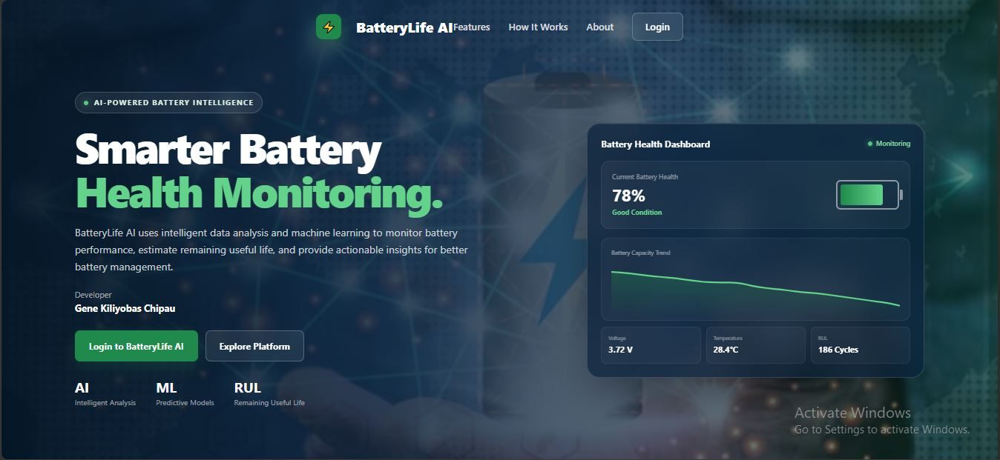

### Login Page

`documentation/Login_Page.JPG`


### Dashboard

`documentation/Dashboard.JPG`

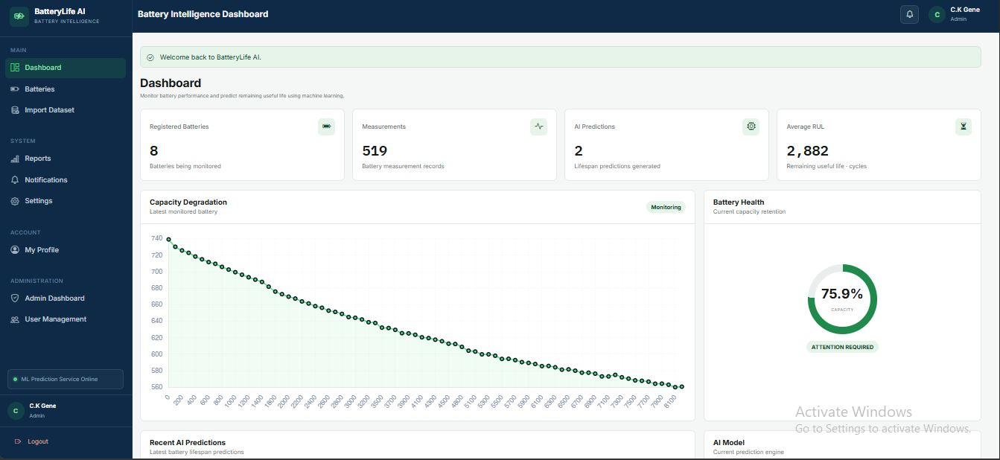

### Battery Management

`documentation/Batteries.JPG`

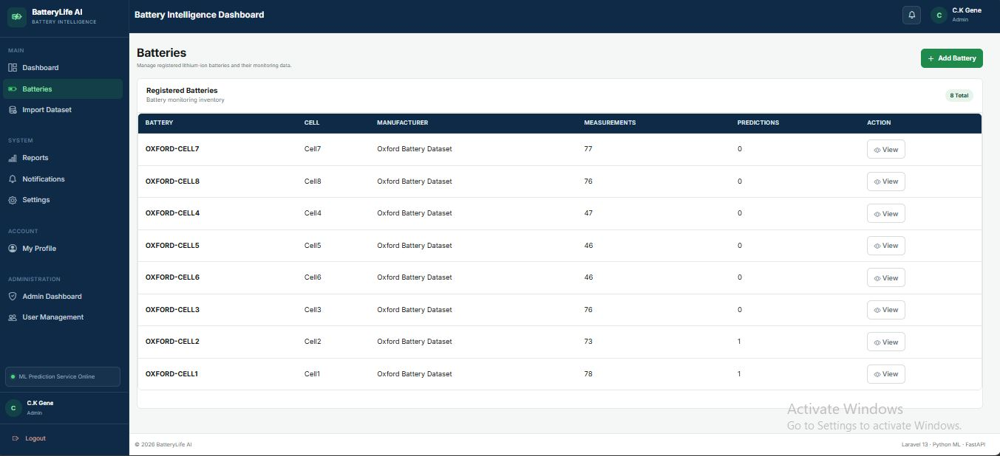

### CSV Import

`documentation/Import_Battery_Dataset.JPG`

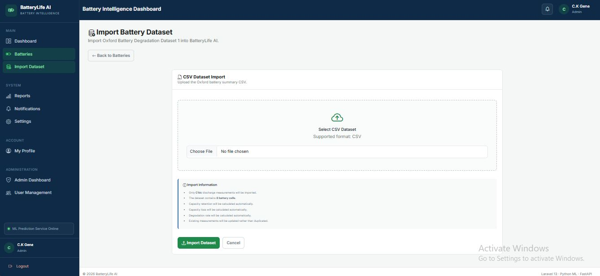

### AI Lifespan Prediction

`documentation/AI_Lifespan_Prediction.JPG`

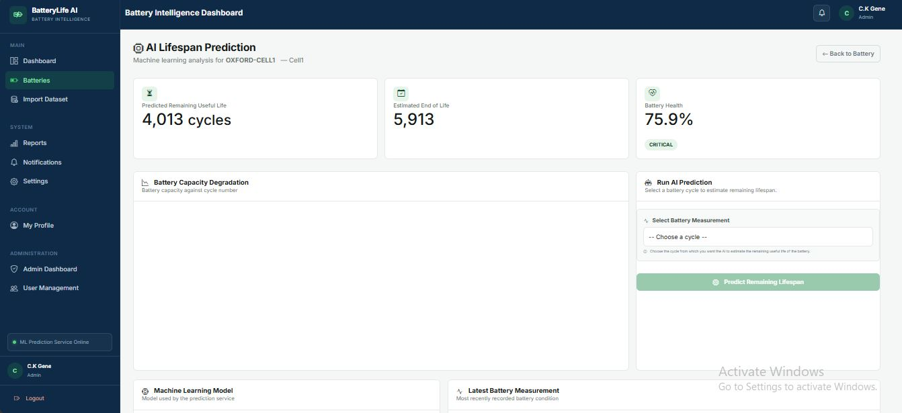

### Battery Degradation Analysis

`documentation/Advanced_Battery_Analytics.JPG`

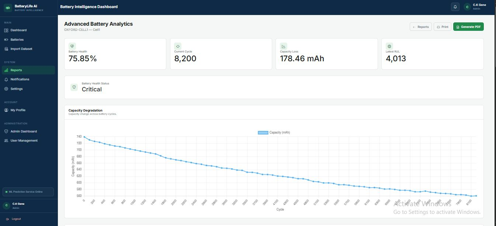

### Reports & Analytics

`documentation/Reports___Analytics.JPG`

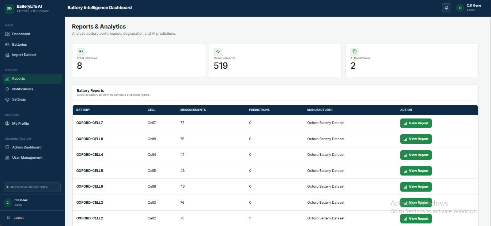

### PDF Report

`documentation/PDF_report.JPG`

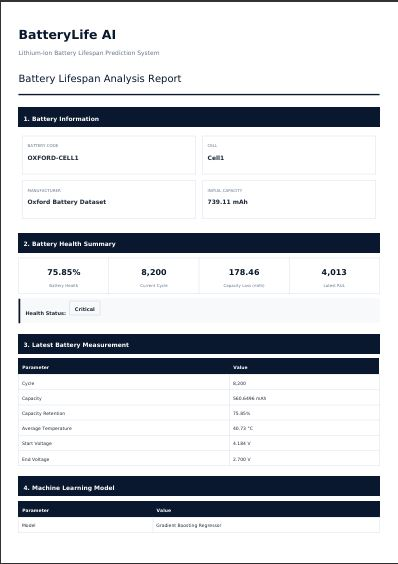

### Notifications

`documentation/Notifications.JPG`

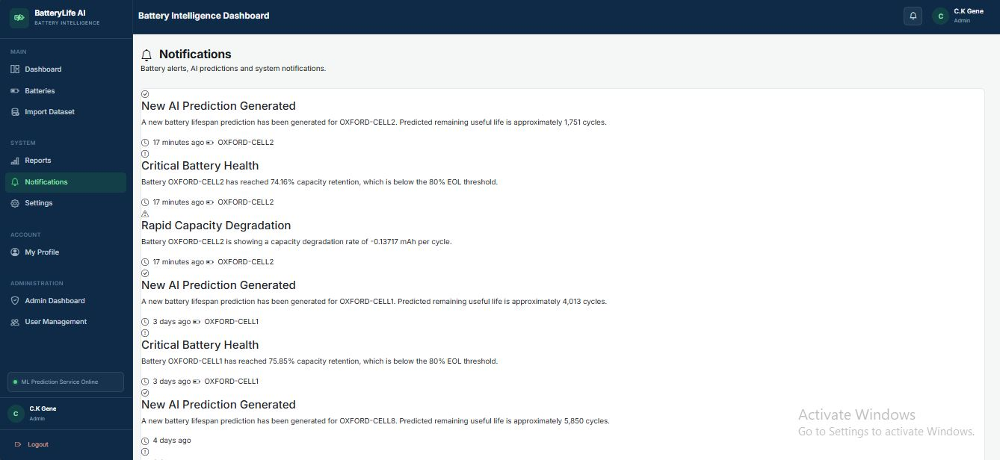

### Administration Dashboard

`documentation/Administration.JPG`

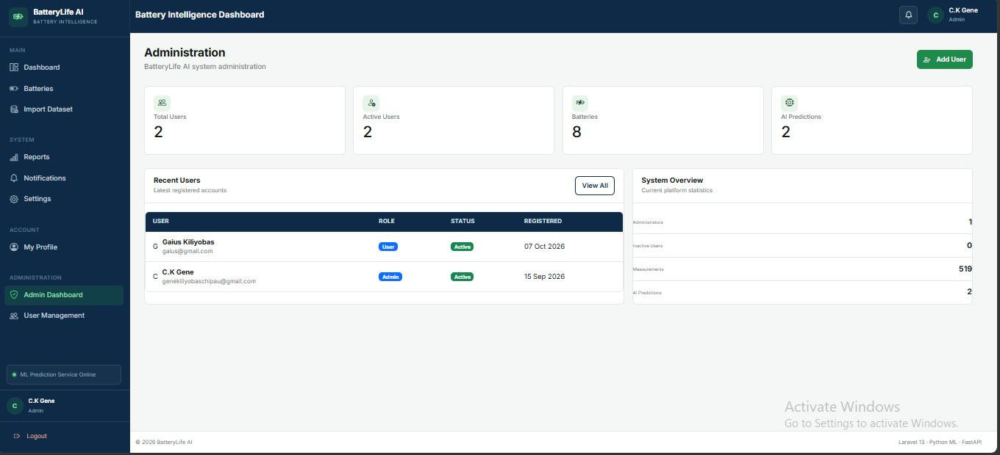

### User Management

`documentation/User_Management.JPG`

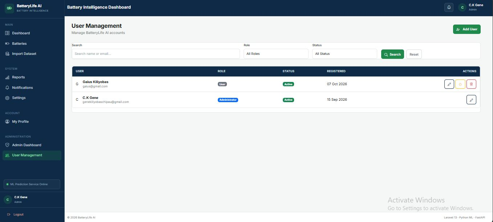

### Profile

`documentation/User_Profile_Page.JPG`

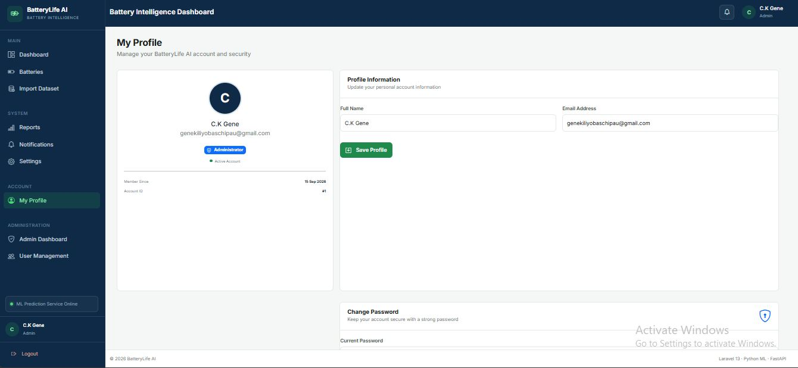

### Settings

`documentation/System_Settings.JPG`

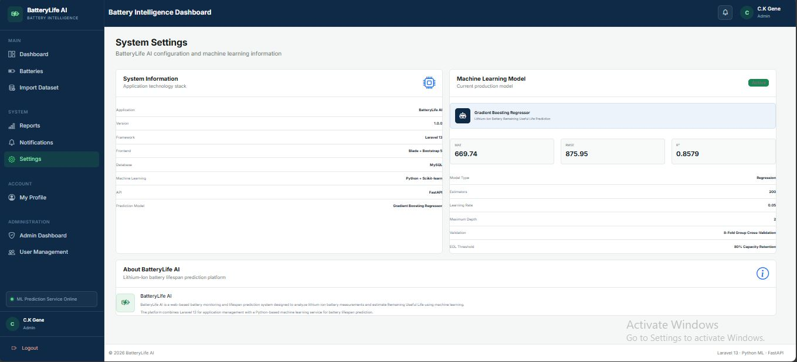

**Note:** GitHub displays an image only when the file exists at the referenced path, and file names are case-sensitive (`.JPG` must match exactly). Replace, rename, or remove image references as needed.

---

## Academic Information

- **Project Name:** BatteryLife AI — Battery Lifespan Prediction System
- **Project Title:** Design and Implementation of a Web Based System for Lithium-Ion Lifespan Prediction Using Machine Learning
- **Developer:** Gene Kiliyobas Chipau
- **Matriculation Number:** 24/155703
- **Department:** Software and Web Development
- **Institution:** Federal Polytechnic Bauchi, Bauchi State, Nigeria
- **Project Type:** Final-Year Academic Project

---

## Future Improvements

Possible future improvements include:

- Evaluating the model with additional battery datasets.
- Testing prediction performance under different operating conditions.
- Comparing additional machine-learning algorithms.
- Improving battery degradation visualisations.
- Expanding reporting and data export options.
- Adding more notification channels.
- Improving API health monitoring and error reporting.
- Strengthening automated testing.
- Introducing more detailed audit logging.
- Preparing deployment configuration for a production environment.

These are potential improvements and should not be interpreted as features that are already implemented.

---

## Contributing

This project was developed as an academic and software development project. Suggestions, bug reports, and improvements are welcome.

1. Fork or clone the repository.
2. Create a feature branch:

   ```bash
   git checkout -b feature/your-feature
   ```

3. Implement and test your changes.
4. Commit your changes:

   ```bash
   git commit -m "Describe your change"
   ```

5. Push the branch:

   ```bash
   git push origin feature/your-feature
   ```

6. Open a pull request if contributions are being accepted through the repository.

---

## License

Refer to the repository's `LICENSE` file for the applicable licensing terms.

If no license file exists, confirm the intended licence before describing the project as open-source software under a specific licence.

---

## Project Status

**Status: Active Development**

BatteryLife AI integrates a Laravel web application with a Python-based machine-learning API for battery management, measurement tracking, Remaining Useful Life estimation, and reporting.

The project demonstrates the integration of web development, database management, API communication, and machine-learning-based predictive analytics.

Further testing and validation remain important when extending the system to new batteries, datasets, or operating environments.